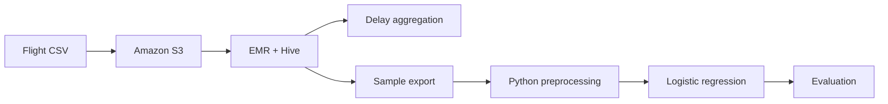

# Technical review — AWS Flight Delay Analytics

## Problem
Explore 2008 U.S. airline delay data with Hive on AWS EMR, then prepare a sample for a Python logistic-regression classification exercise.

## Workflow

## What reviewers should verify

1. Dataset provenance and any documented sampling assumptions.
2. Hive schema and queries, including delay units and null handling.
3. Train/test separation and any preprocessing fitted on training data only.
4. Evaluation outputs and whether metrics come from a held-out sample.
5. AWS setup requirements, costs, and cleanup instructions before rerunning.

## Scope
This is a learning/portfolio workflow, not a claim of a continuously running production pipeline. AWS resources should not be launched without checking expected charges. See the main README for project-specific details.
